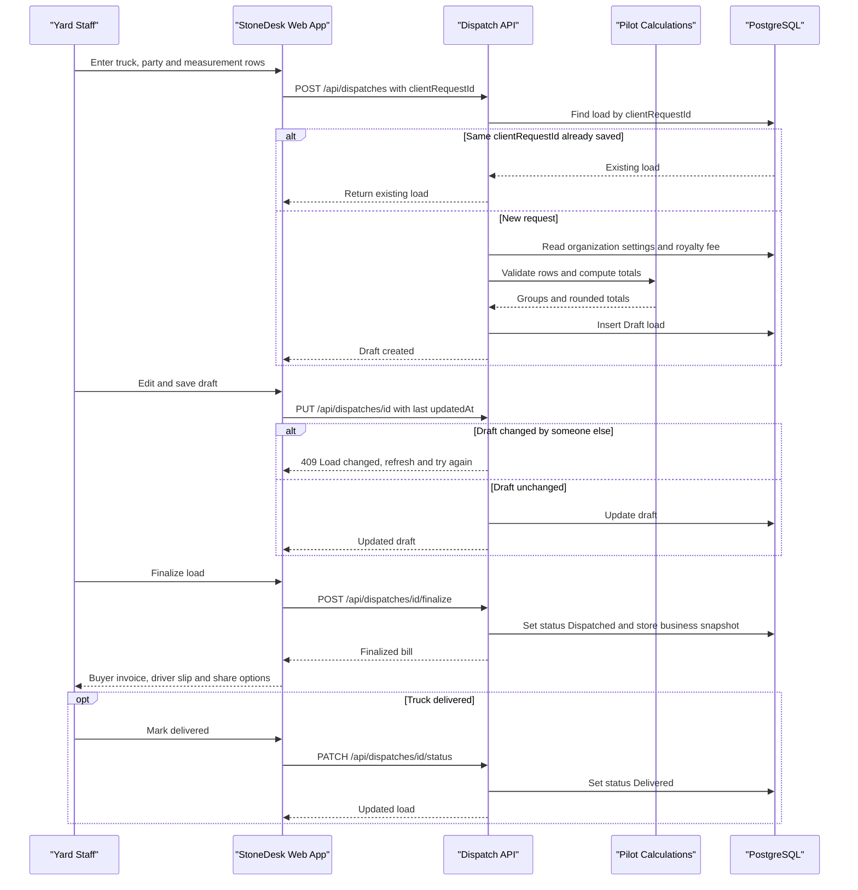

# Business Workflows

StoneDesk records granite and stone truck loads for a business (organization), turns each load's measurements into a bill, and tracks the load from draft to delivery. This document maps the domain entities, the main workflows and the business rules enforced by the backend.

## Domain Entities

| Entity | Service / Bounded Context | Description | Key Relationships |
| --- | --- | --- | --- |
| Organization (`MasterSettings`) | Business settings | Tenant root: business profile, logo, saved trucks and destinations, stone rates, default royalty fee | Owns Users, Dispatches, LoadingLists |
| User | Identity and access | A member of one organization with a role (Admin, Manager, Dispatcher; Manager is the `YardManager` enum) and an active flag | Belongs to Organization; has Sessions and PasswordResetTokens |
| Session | Identity and access | Server-side login session behind the `stonedesk_session` cookie | Belongs to User |
| PasswordResetToken | Identity and access | Single-use, 1 hour token for password reset by email | Belongs to User |
| Dispatch (Load) | Loads and billing | One truck load: logistics, measured stone groups, totals and a business snapshot at finalize | Belongs to Organization; priced from Organization stone rates |
| LoadingList | Loading requirements | Required sizes and quantities to load for a buyer, with loaded pieces and balance | Belongs to Organization |
| AuditLog | Audit | Record of security and business actions (signup, role change, account delete, password reset) | References Organization and User by id |

## Service-to-Domain Mapping

| Module | Domain responsibility |
| --- | --- |
| `routes/authRoutes.js`, `utils/auth.js`, `utils/googleAuth.js` | Signup, login, Google sign-in, sessions, team members, password reset, account deletion |
| `routes/masterSettingsRoutes.js`, `controllers/masterSettingsController.js`, `utils/businessBranding.js` | Business profile, logo, trucks, destinations, stone rates, royalty fee |
| `routes/dispatchRoutes.js`, `controllers/dispatchController.js`, `utils/pilotCalculations.js` | Load drafts, finalize, delivery status, list, bill totals |
| `utils/dispatchAnalytics.js` | 30-day dashboard analytics |
| `routes/loadingListRoutes.js`, `controllers/loadingListController.js` | Loading requirement lists |
| `utils/auditLog.js`, `utils/email.js` | Audit trail and outbound email |
| `Frontend/src/components/pilot/*` | User-facing workflows: setup, new load, bill, dashboard, settings |
| `Frontend/src/utils/pilotExports.js`, `a4Invoice*.js`, `shareFiles.js` | Buyer invoice, driver slip, Excel and sharing |

## Primary Workflows

### 1. Create a business (organization)
1. A new user signs up with name, email, password and `createOrganization=true` plus a business name.
2. The server creates the organization and the user in one transaction. The user becomes Admin.
3. A shareable organization code is generated from the business name (retried on collision).
4. The app sends the Admin to business setup (`#profile`) until a business name exists. If there are no products yet, saving setup opens New load (`#load`), where the first product can be added.

### 2. Join an existing business
1. A user signs up with an organization code instead of a business name.
2. The code must match exactly one organization that has an active Admin.
3. The user joins as a Dispatcher with access active. The Admin can later change the role or pause access.

### 3. Sign in
- **Password:** email and password create a 12 hour session.
- **Google:** the Supabase PKCE code is exchanged on the server. A linked user is signed in. An unlinked Google email returns either "needs signup" or "needs link"; linking requires the StoneDesk password and replaces existing sessions.

### 4. Business setup (Admin)
1. Save the business profile: name, address, phone, GST number, trade license.
2. Upload a PNG or JPEG logo (up to 2 MB).
3. Set the default royalty / loading fee. Products (stone type, finish, rate) are added in Settings > Products & rates (`#settings/products`) or from New load.
4. Trucks and destinations need no setup: they are remembered automatically whenever a load is saved and offered as suggestions in New load.

### 5. Record a load (core workflow)
1. Any active member starts a new load (`#load`, from the New load menu item or header button) with truck number, destination, manager and party name.
2. Measurements are entered per product group as rows of length, width, quantity, category (Regular or TOP) and row number. Fractions are supported.
3. Each product group carries a per square foot rate that defaults from the product's rate. The draft is saved with a client-generated `clientRequestId`; the server validates rows and rates and computes totals.
4. The draft can be edited. Each save checks the last `updatedAt`, so concurrent edits are rejected instead of overwritten.
5. An Admin or Dispatcher finalizes the draft. Status becomes Dispatched and a snapshot of the business profile is stored with the bill.
6. The bill view (`#bill/:id`) offers the buyer invoice (PDF / Excel / A4), the driver slip without prices, and native sharing.
7. When the truck arrives, an Admin or Dispatcher marks the load Delivered.

### 6. Loading requirements
1. Admin, Manager or Dispatcher creates a loading list with buyer destination, stone type, finish and required sizes and quantities.
2. Loaded pieces are recorded against each size; balance is required minus loaded.
3. Admin or Dispatcher sets the status (Draft, Loading, Completed). Only Admin can delete a list.
4. The list can be exported as PDF or Excel.

### 7. Dashboard analytics
The dashboard shows status counts, daily totals and top destinations for the last 30 days compared with the previous 30 days, in India time. Only Dispatched and Delivered loads count.

### 8. Team management (Admin)
The Admin lists members and changes their role or active flag. Admin accounts and the Admin's own account cannot be changed. Pausing a user or changing an active user's role ends their sessions.

### 9. Password reset
1. The user requests a reset by email. The response is the same whether the email exists or not.
2. A single-use token valid for 1 hour is emailed as a link.
3. Submitting the token, email and a new strong password updates the password and marks the token used.

### 10. Account deletion
The user types their email to confirm. An Admin deletes the entire organization and its data; any other user deletes only their own account.

## Cross-Service Data Flows

- **Organization to Load:** product rates prefill each load's group rates and the default royalty fee applies when none is given; the business profile is copied into the load at finalize so old bills keep the details in effect when they were issued.
- **Load to Analytics:** finalized loads (Dispatched and Delivered) feed the 30-day analytics.
- **Load to Documents:** the frontend builds invoices, driver slips and Excel files from the saved load; it never recalculates billed totals differently from the server (guarded by calculation parity tests).
- **User to Sessions:** role changes, pausing, Google linking and password changes invalidate sessions.
- **All actions to Audit:** sensitive actions write AuditLog entries keyed by organization and user.
- **Browser to Server drafts:** unsaved load input is kept in `localStorage` and offered for recovery.

## Business Workflow Sequence

<!-- mermaid-checked: every participant uses `participant Id as "Label"`, no \n in aliases/messages/notes, every alt/opt/loop closed by end, no `:` inside any alias -->

## Business Rules & Decision Logic

### Access and roles
- Users only see data of their own organization.
- Paused users can still sign in but get 403 "access paused" on workspace APIs.
- Admin only: business profile, logo, editing and removing stone rates, royalty fee, removing truck/destination suggestions, team management, deleting loading lists.
- Admin or Manager: add products (`POST /stone-rates`).
- Admin or Dispatcher: finalize loads, mark loads Delivered, change loading list status.
- Manager: can record drafts and loading lists and add products but cannot finalize.
- Every dispatch save remembers its truck number and destination as suggestions (de-duplicated, newest first); this never fails the save.

### Signup and passwords
- Passwords are 12 to 128 characters with a zxcvbn strength score of at least 3.
- Organization codes are letters, digits and hyphens (up to 50), matched case-insensitively.
- Auth endpoints are limited to 20 requests per 15 minutes.

### Loads
- Status flow is Draft, then Dispatched (finalize), then Delivered. Only drafts can be edited.
- `clientRequestId` (8 to 80 letters, digits or hyphens) makes draft creation safe to retry.
- Slip numbers are generated as `GS-` plus a random UUID and are unique per organization.
- Measured loads require a party name, a business name and at least one stone rate.
- The royalty / loading fee defaults to the organization's default royalty fee.
- Truck number is upper-cased and up to 40 characters; destination up to 200; supervisor up to 120.

### Calculations
- Up to 200 product groups per load, 1000 measurement rows and 10000 pieces per group.
- Row quantity is a whole number from 1 to 100000; category is Regular or TOP; row number is 1 to 20.
- Row area is length x width x quantity in square feet.
- Areas and amounts are summed unrounded and rounded half-up to 2 decimals once at the end.
- Net billable amount is the base material total plus loading and royalty fees.

### Analytics
- Windows are the current and previous 30 days in Asia/Kolkata time.
- Only Dispatched and Delivered loads are counted, capped at 20000 records per query.
